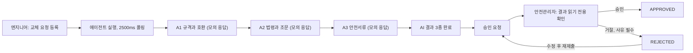

# Argus: 반도체 설비 부품 교체 승인 프로세스 에이전트

> 설비 부품 교체 요청에 대해 에이전트 3개(규격과 호환, 법령과 조문, 안전서류)가 근거를 붙이고, **승인과 거절은 안전관리자가 정하는** 흐름을 설계하고 구현한 저장소다. **에이전트 응답은 고정 예시(모의, Mock JSON)이며, 이 저장소가 보여 주는 것은 승인 흐름과 상태 관리다.** LLM 구현체는 자리(NotImplementedError)만 있고 실제 LLM 호출 모드는 없다. 승인 시간 단축 효과는 측정하지 않았으므로 주장하지 않는다.

On-premise approval workflow for semiconductor fab part replacement: three agents (fixed-JSON mocks in this 3-day scope, LLM classes are stubs) attach evidence, and the safety manager decides (SKALA Cohort 4 mini-project, Sep 2026).

> **이 저장소에 대한 주의**: 이 저장소는 5인 팀 작업과 병행해 만든 **개인 저장소**입니다. 아래 화면, 기술 스택(FastAPI, Vue 3), 수치는 이 저장소 기준이며, **5인 팀의 공식 구현은 Java와 Spring Boot**입니다.

SKALA 4기 미니 프로젝트 "AI 웹 서비스 설계", 2026-09-02 ~ 09-04(3일), 5인 팀
프레임: 우리는 SK AX AI 도메인팀이며, 유해가스 취급 설비를 가진 반도체 제조사(하이닉스 협력사, 후공정)에 B2B AX 솔루션을 제안한다.


> 에이전트 3종이 순서대로 실행되는 동안 화면이 서버가 지정한 2500ms 간격으로 진행 상태를 폴링한다(이 개인 저장소의 구현 화면, 샘플 데이터).

## 내 역할

**장병헌: 백엔드 설계, 최종 발표** (5인 팀)

- 에이전트 JSON, 프롬프트, 상태머신, 오케스트레이터와 승인 단계 설계(`docs/05_ai_ready/`, `backend/app/services/`)
- 최종 발표 스크립트와 Q&A 준비(`docs/08_presentation/`)
- 현직자 통화 인터뷰는 팀원이 진행했고, 처음 세운 가설 두 개가 틀린 것으로 확인되어 발표자료에 남겼다.

### 승인 흐름



`AI 결과는 근거로만 쓰고 승인과 거절은 사람이 한다.` 에이전트 실행 순서는 코드의 `AGENT_ORDER`(A1, A2, A3 순차, `backend/app/core/enums.py`, `backend/app/services/agent_service.py`)를 따른다. `AI_PROVIDER` 기본값은 `MOCK`이고, `MOCK` 외의 값(`LOCAL_LLM`, `AX_PLATFORM`, `OPENAI`)을 주면 `llm_agents.py`의 클래스가 선택되지만 구현이 없어 `NotImplementedError`가 난다. 외부 전송은 기본으로 막혀 있다(`egress_allowed=false`).

---

## 1. 문제와 솔루션

| | 내용 |
|---|---|
| **문제 (As-Is)** | 규격 확인, 법령 조사, 안전 승인에 필요한 정보가 여러 곳에 흩어져 있고, 대상 협력사는 보안상 외부 클라우드 LLM을 쓸 수 없다. 현직자 통화 인터뷰(팀원 진행)에서 처음 세운 가설 두 개가 틀린 것으로 확인되었다. |
| **솔루션 (To-Be)** | 온프레미스에서 도는 **에이전트 팀**. A1 규격과 호환 / A2 법령과 조문 / A3 안전서류 3개 에이전트가 순서대로 실행되고(이 저장소에서는 고정 JSON 모의 응답), 결과를 안전관리자의 **승인 화면**(AI 결과물 읽기 전용, 승인 또는 거절과 사유)으로 넘긴다. 승인과 거절은 사람이 한다 (Human-in-the-loop). |
| **AI 확장 지점** | 에이전트는 공통 인터페이스 뒤에 두었고, 3일 범위는 Mock(고정 JSON) 구현체다. 이후 LLM 구현체로 교체할 수 있게 설계했다. AI 공급자 기본값은 Mock, 외부 전송은 기본 차단(`egress_allowed=false`)이며, 외부 공급자를 지정하고 외부 전송이 꺼져 있으면 서버가 기동을 거부한다(`backend/app/core/config.py`, `docs/CONTRACT.md` 10절). |

## 2. 아키텍처 한 줄

`Vue 3 + Vite` ⇄ REST JSON ⇄ `FastAPI (요청 API, 에이전트 오케스트레이션[Mock], 승인 상태머신)` ⇄ `PostgreSQL(Supabase) / 로컬 SQLite` 상세: [docs/04_architecture](docs/04_architecture/)

```
[웹 Vue/Vite] ◀─REST─▶ [FastAPI] ─┬─ 에이전트 3종 A1 규격, A2 법령, A3 안전서류 (Mock → LLM)
                                   ├─ 상태 DRAFT → AI_RUNNING → AI_DONE → PENDING → APPROVED | REJECTED
                                   └─ 환경변수 설정 계층 (AI 공급자 Mock 기본, egress_allowed=false)
                                            │
                                   [PostgreSQL / SQLite]
```

## 3. 폴더 구조

```
argus/
├── README.md                      ← 이 문서
├── HANDOFF.md                     ← 인수인계 메모(구현, 검증 현황)
├── .gitignore / .github/PULL_REQUEST_TEMPLATE.md
├── docs/
│   ├── CONTRACT.md                ← 공통 계약서 (상태값, API, JSON 스키마, 샘플 데이터), 모든 산출물의 기준
│   ├── 01_planning/               ← 기획서, R&R, 일정, GitHub 운영 가이드
│   ├── 02_usecase/                ← Actor, Use-Case 7개 (UC-01~07)
│   ├── 03_wireframe/              ← 핵심 화면 2개 와이어프레임 (목록/대시보드, 상세=타임라인+승인 패널)
│   ├── 04_architecture/           ← FE-BE-DB 아키텍처 다이어그램, AI 확장 지점
│   ├── 05_ai_ready/               ← 프롬프트(A2 법령 에이전트), AgentRun JSON 스키마, AI-Ready 4원칙
│   ├── 06_erd/                    ← ERD (dbdiagram DBML, 8개 테이블, 정규화 근거)
│   ├── 07_api/                    ← OpenAPI 3.0 명세, Method/Path/Status 표
│   ├── 08_presentation/           ← 발표 스크립트(15분), 예상 Q&A
│   ├── 09_qa/                     ← E2E 연동 테스트 체크리스트, 루브릭 자체 점검표
│   └── 10_project_record/         ← 타임라인, 증빙, 계약 이력, 회고
├── frontend/                      ← Vue 3 + Vite + axios (mock 모드 지원)
│   └── src/ (router, store, views, components, api, mock)
├── backend/                       ← FastAPI (Python 3.11)
│   └── app/ (api/v1/routers, services/agents, repositories, models, schemas, db, core)
├── scripts/                       ← 라이브 E2E 실행 스크립트(e2e_live_v3.sh 등)
└── postman/                       ← Postman Collection + Mock 서버 예시 응답
```

## 4. 빠른 시작

> **사전 요구**: Python **3.10 이상**, Node **18 이상**.
> 모델 정의가 `Mapped[str | None]` (PEP 604) 문법을 쓰므로 Python 3.9 이하에서는
> `MappedAnnotationError` 로 기동이 실패한다. macOS 기본 `python3` 은 3.9 이므로
> `python3.11 -m venv` 처럼 버전을 명시해서 만든다.

### Backend (FastAPI)
```bash
cd backend
python3.11 -m venv .venv && source .venv/bin/activate  # Windows: .venv\Scripts\activate
python -V                                              # 3.10 이상인지 확인
pip install -r requirements.txt
cp .env.example .env                                   # 환경변수 예시(기본 설정은 파일 참고)
uvicorn app.main:app --reload --port 8000
# Swagger: http://localhost:8000/docs   (샘플 데이터는 기동 시 자동 시드)
```

### Frontend (Vue 3 + Vite)
```bash
cd frontend
npm install
cp .env.example .env
npm run dev              # http://localhost:5173 , vite proxy 가 /api → localhost:8000 으로 전달
npm run dev:mock         # 백엔드 없이 src/mock/data.js 인메모리 Mock 으로 동작 (VITE_USE_MOCK=true)
```

### Postman Mock (백업 경로)
`postman/` 컬렉션을 Import → Mock Server 생성 → `frontend/.env` 의 `VITE_API_BASE` 를 Mock URL 로 교체.

## 5. 데모 시나리오

데모 계정은 `HANDOFF.md`에 있다(기동 시 샘플 데이터 자동 시드). 흐름은 `docs/CONTRACT.md` v3.0 기준이다.

| 순서 | 화면 | 행동 | API | 상태 |
|---|---|---|---|---|
| 1 | 엔지니어 요청 등록 | 설비, 라인, 물질, 운전 조건, 제품 스펙을 입력해 등록 | `POST /work-requests` | `DRAFT` 또는 등록 |
| 2 | AI 검증 진행 | 에이전트 실행, 서버가 지정한 2500ms 간격으로 진행 상태 폴링 | `POST …/agent-runs`, `GET /agent-runs/{runId}` | `AI_RUNNING` → `AI_DONE` |
| 3 | 결과 검토 | A1, A2, A3 결과 확인, 엔지니어 메모 작성 후 승인 요청 | `PATCH …/submit-approval` | `PENDING` |
| 4 | 안전관리자 승인 화면 | AI 결과물(읽기 전용) 확인 후 승인 또는 거절(사유 필수) | `POST /approvals` | `APPROVED` 또는 `REJECTED` |

승인 시간이나 처리 건수 같은 효과 수치는 측정하지 않았다. 화면의 샘플 값은 가상 데이터다.

## 6. 산출물 ↔ 루브릭 매핑

### 정량 60%, 서비스 기획 & 아키텍처 (30점)
| 루브릭 항목 | 근거 산출물 |
|---|---|
| Use-Case, 와이어프레임 완성도 | `docs/02_usecase/`, `docs/03_wireframe/`, 기획서 `docs/01_planning/` §5, §6 |
| AI 확장 지점, 프롬프트와 JSON 타당성 | `docs/05_ai_ready/` (프롬프트, AgentRun JSON), `docs/CONTRACT.md`, `backend/app/services/agents/` |
| GitHub 관리, R&R 적절성 | `docs/01_planning/rnr_and_schedule.md`, `docs/01_planning/github_guide.md`, `.github/PULL_REQUEST_TEMPLATE.md`, 커밋 이력 |
| FE-BE-DB 다이어그램 명확성 | `docs/04_architecture/` |

### 정량 60%, 시스템 설계 & 스캐폴딩 (30점)
| 루브릭 항목 | 근거 산출물 |
|---|---|
| ERD 1:N, N:M, 정규화 | `docs/06_erd/` (DBML, 8개 테이블, 정규화 근거) |
| Mock API RESTful 규격 준수 (Method/Path/Status) | `docs/07_api/` (OpenAPI 3.0), `docs/CONTRACT.md` §REST API, `postman/` |
| FE/BE 구조, DB 연동 | `frontend/src/`, `backend/app/` (routers → services → repositories → models), `backend/.env.example` (`DATABASE_URL`) |
| Mock API 데이터 바인딩 화면 시연 | `frontend/src/views/` (화면1, 화면2), `docs/09_qa/e2e_test_checklist.md`, 데모 시나리오 §5 |

### Peer 40%
| 항목 | 근거 |
|---|---|
| 기획, UX | 문제 정의, 핵심 화면, 데모 |
| 시스템 설계 | ERD, OpenAPI, 상태머신(상태 충돌 409) |
| AI-Ready 확장성 | Interface First, Structured Data, Async Pipeline(폴링), Security & Config Isolation(환경변수 설정 계층) |
| 구현과 발표 | 에이전트 진행 화면 시연, `docs/08_presentation/` |

## 7. 팀 R&R

아래 표는 5인 팀 전체의 역할 분담(팀 작업 기준)이며, 이 개인 저장소의 커밋은 장병헌 계정입니다.

| 이름 | 역할 | 담당 산출물 | 담당 파일/폴더 |
|---|---|---|---|
| **은태현** | PM, DBA | 일정, R&R, 기획서 확정, 샘플 데이터, ERD, DB 연결, 발표 슬라이드 | `docs/01_planning/`, `docs/06_erd/`, `backend/app/models/`, `backend/app/db/`, `docs/08_presentation/` (슬라이드) |
| **문승은** | Product & UX, FE | Use-Case 7개, 와이어프레임 2장, FE 화면 2개(타임라인, 승인 패널), Mock 데이터 바인딩 | `docs/02_usecase/`, `docs/03_wireframe/`, `frontend/src/` |
| **신서현** | DevOps & Infra | GitHub 레포, 브랜치, PR 템플릿, 환경 구성(.env, CORS, proxy), FE-BE 연동, E2E 테스트, 데모 운영 | `.github/`, `.gitignore`, `docs/01_planning/github_guide.md`, `docs/09_qa/`, `frontend/vite.config.js`, `backend/.env.example` |
| **정구현** | API Architect, BE | 아키텍처 다이어그램, OpenAPI 3.0, Postman Mock, 요청, run, 승인 라우터 | `docs/04_architecture/`, `docs/07_api/`, `postman/`, `backend/app/api/v1/routers/`, `backend/app/schemas/` |
| **장병헌** | BE, 발표 | 에이전트 JSON, 프롬프트, 상태머신, 오케스트레이터, 승인 게이트 구현, 발표, Q&A | `docs/05_ai_ready/`, `backend/app/services/`, `backend/app/services/agents/`, `docs/08_presentation/` (스크립트) |

상세 일정(시간 단위), 리스크는 [docs/01_planning/rnr_and_schedule.md](docs/01_planning/rnr_and_schedule.md), 협업 규칙은 [docs/01_planning/github_guide.md](docs/01_planning/github_guide.md).

## 8. 라이선스와 주의

- 본 저장소는 SKALA 교육 과정의 Mini-project 산출물이며, 코드는 팀 내부 학습, 발표 목적으로 사용한다. LICENSE 파일이 없으므로 라이선스는 지정되어 있지 않다.
- **샘플 데이터는 전부 가상**이다. 회사명(○○반도체), 사용자(김민준, 이정호, 박수진), 설비, 부품 번호, 구매 이력은 예시이며 실제 기업, 개인과 무관하다.
- **법령 요약, 조문 인용(산업안전보건기준에 관한 규칙 91, 92, 93, 319조, 화학물질관리법 24조, 고압가스 안전관리법 시행규칙 별표)은 발표용 예시 발췌**이다. 실제 적용 시 법제처 국가법령정보(https://www.law.go.kr) 원문과 최신 개정 사항을 반드시 확인해야 하며, 에이전트 출력은 안전관리자의 판단을 대체하지 않는다.
- 에이전트 3개는 모두 Mock(고정 JSON) 구현이며, LLM, RAG, ERP, 벤더 포털 연동은 확장 범위다 (기획서 §12).
- 라이브 E2E 72건 통과, 0건 실패는 이 개인 저장소의 실행 로그 기준이다(`docs/10_project_record/README.md`). 5인 팀 공식 저장소(Java, Spring Boot)의 수치가 아니다.
