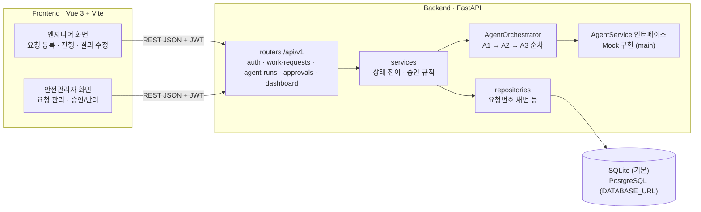

# Argus Solo — 반도체 설비 부품 교체 승인 워크플로 (개인 재구현)

> 설비 엔지니어가 부품 교체 요청을 올리면 AI 에이전트 3종(규격·법령·안전서류, 현재 규칙 기반 Mock — 법령 에이전트 LLM 구현은 진행 중)이 순서대로 검토 근거를 만들고, 안전관리자가 그 근거를 보고 승인·반려하는 **Human-in-the-loop 승인 워크플로**를 FastAPI + Vue 3로 구현했다.

[](https://github.com/jang961111-hash/skala-argus/actions/workflows/ci.yml) 

**데모**: 배포본 없음 (로컬 실행 → [실행 방법](#실행-방법)) · **기간**: 2026.09.02 – 09.04 (구현 커밋은 09.03 하루) · **맥락**: SKALA 4기 Full-Stack Engineering "AI 웹 서비스 설계 Mini-project", 5인 팀 · 공식 순위·수상 없음

**스택**: Python 3.11 · FastAPI · SQLAlchemy 2.0 · Pydantic 2 · PyJWT · bcrypt · Pillow · Vue 3.4 · Vite 5 · vue-router 4 · axios · SQLite / PostgreSQL 17 · GitHub Actions

> **이 레포는 팀 공식 산출물이 아니다.**
> 팀 공식 레포는 [Taeyum/skala-fixguide](https://github.com/Taeyum/skala-fixguide) (Spring Boot, 팀장 은태현)다. 팀에서 내 역할은 **발표 + 백엔드 + 팀장·팀원 사이 가교**였다.
> 이 레포(skala-argus)는 팀 협업과 **동시에** 내가 개인적으로 Claude 에이전트 트랙을 병렬로 돌려 FastAPI + Vue 3로 다시 만든 **백업·보완용 개인 재구현**이다. `docs/` 안의 "은태현 담당", "신서현 담당" 같은 이름은 실제 팀원이 이 레포를 작성했다는 뜻이 아니라, **팀 R&R을 에이전트 트랙에 매핑해 붙인 표기**다. 커밋이 2026-09-03 하루(14:14~22:06)에 몰려 있는 것도 이 "1일 병렬 스프린트" 방식 때문이다. 이 레포의 커밋은 전부 내 계정 1개다.


## 현재 상태 (먼저 읽기)

- **main의 에이전트 3종은 전부 Mock이다.** 고정 JSON을 반환하고, `AI_PROVIDER` 설정으로 구현체를 갈아 끼울 수 있는 인터페이스(`backend/app/services/agents/base.py`)까지만 있다. main의 `llm_agents.py`는 `NotImplementedError` 스텁이다.
- A2 법령 에이전트의 실제 LLM(Claude) 구현은 별도 브랜치 `feat/a2-legal-llm`에서 **진행 중**이다. 아직 실측 수치가 없어 이 README에는 수치를 싣지 않는다.
- 사후 점검에서 찾은 채번 버그 수정은 **PR #1**([링크](https://github.com/jang961111-hash/skala-argus/pull/1), 머지 전)로 올라가 있다.

## 핵심 수치

전부 **2026-09-28 재측정** 값이다(Apple M5, Python 3.11.15, 단일 uvicorn, `AI_PROVIDER=MOCK`, 시드 데이터). AI가 Mock이므로 응답시간에 LLM 호출 비용은 들어 있지 않다.

| 지표 | 값 | 측정 방법 (측정일) |
|---|---|---|
| 백엔드 테스트 | pytest **30 passed / 0 failed**, 3회 연속 동일 (약 2.2~2.4s) | `cd backend && python -m pytest -q` ×3 (2026-09-28 재측정) |
| 테스트 커버리지 | 라인 **94%** (1,648문 중 99문 미실행) · 브랜치 **92%** | `python -m pytest --cov=app --cov-branch --cov-report=term-missing` (2026-09-28 재측정) |
| 라이브 E2E | **72 통과 / 0 실패, 3회 연속**, 회당 약 5초 | `bash scripts/e2e_live_v3.sh` ×3, 실제 uvicorn 대상 (2026-09-28 재측정) |
| 조회 API 응답시간 (SQLite) | p50 **7.5~14.2ms** · p95 **11.0~51.6ms** (`/auth/me`, 목록, 상세, 대시보드 4종의 3라운드 최저~최고) | 자체 벤치 스크립트, 300요청 × 동시성 10 × 3라운드, 워밍업 20건 제외 (2026-09-28 재측정) |
| PostgreSQL 실기동 | 기동 성공, 7개 테이블이 uuid·jsonb·enum·timestamptz로 생성, 응답 시각 `+09:00` 유지 | `DATABASE_URL=postgresql+psycopg2://…` 로 uvicorn 기동 → `psql` 스키마 조회 (2026-09-28 재측정) |
| 요청번호 채번 동시성 | 동시성 10·50에서 각 100건, SQLite·PostgreSQL 모두 **중복 0** | 동시 `POST /work-requests` 후 응답·DB 양쪽에서 `requestNo` 중복 집계 (2026-09-28 재측정) |
| 프런트 번들 | JS **223.88 kB** (gzip 81.98 kB), 118 modules, vite 빌드 약 0.5s | `cd frontend && npm ci && npm run build` ×3 (2026-09-28 재측정) |

**알려진 한계 (같은 측정에서 발견, 미해결)**: SQLite 모드에서 동시 요청이 **80 이상**이면 서버가 약 30초 멈춘 뒤 500을 낸다(동시성 70까지는 200건 전부 성공). 같은 조건의 PostgreSQL은 동시성 100에서도 200건 전부 성공(0.91s)했다. 서버 로그에 `QueuePool limit of size 5 overflow 10 reached`가 찍히지만 원인은 아직 가설 단계다.

## 내가 한 일

모든 커밋이 내 계정 하나다. 구현은 Claude 에이전트 트랙에 나눠 맡기고, 나는 계약·지시·검수·통합을 맡았다.

- **계약 주도 병렬 개발 지휘**: 단일 계약서 `docs/CONTRACT.md`(v3.0)를 기준으로 기획·API·DB·BE·FE 트랙을 병렬로 돌리고 `develop`으로 통합했다. 커밋 [`757e848`](https://github.com/jang961111-hash/skala-argus/commit/757e848)(계약 v3.0), [`f98d119`](https://github.com/jang961111-hash/skala-argus/commit/f98d119)(BE v3.0), [`1cd8eba`](https://github.com/jang961111-hash/skala-argus/commit/1cd8eba)(FE 화면)
- **백엔드**: JWT 인증, 요청 6상태 머신, 에이전트 오케스트레이터(A1→A2→A3 순차), 승인·반려 규칙, 단일 에러 포맷, 사진 업로드(EXIF 제거·썸네일). API 15개 + `/health`
- **검증 체계**: pytest 30개, 실서버 대상 라이브 E2E 72건, GitHub Actions 3잡(pytest · FE build가 통과하면 E2E). E2E 스크립트 자체의 버그 2건을 잡아 고쳤다 → [트러블슈팅](docs/TROUBLESHOOTING.md) 2·3번. 커밋 [`745683c`](https://github.com/jang961111-hash/skala-argus/commit/745683c)
- **사후 보완(2026-09)**: 커버리지·응답시간·PostgreSQL·동시성 재측정, 측정 중 발견한 채번 999 초과 버그 수정 → **PR #1**

## 아키텍처



요청 상태: `DRAFT → AI_RUNNING → AI_DONE → PENDING → APPROVED / REJECTED` (반려되면 수정 후 재제출). 에이전트 진행은 폴링 방식이다. 기본 설정에서는 `GET /agent-runs/{id}`를 호출할 때마다 step이 하나씩 진행되고, `BACKGROUND_ADVANCE=true`로 두면 GET은 읽기 전용이 되고 BackgroundTasks가 진행시킨다.

DB 테이블 7개: `users`, `work_requests`, `work_request_photos`, `agent_runs`, `agent_steps`, `agent_results`, `approvals` (`grep -n __tablename__ backend/app/models/*.py`).

## 기술적 결정

| 결정 | 대안 | 선택 이유 | 대가(trade-off) |
|---|---|---|---|
| 에이전트를 `AgentService` 인터페이스 뒤에 두고 `AI_PROVIDER`로 구현체 교체 | 라우터에서 LLM 직접 호출 | 3일 범위에서는 Mock으로 흐름 전체를 먼저 완성하고, 나중에 구현체만 바꾸기 위해 | main에는 실제 AI 동작이 없다 |
| 외부 AI 공급자인데 `EGRESS_ALLOWED=false`면 **기동 거부** (`config.py`) | 호출 시점에 경고만 | 온프레미스 전제에서 설정 실수로 사내 데이터가 밖으로 나가는 것을 막기 위해 | 설정 항목이 하나 늘어난다 |
| 에이전트 진행을 폴링 + "GET마다 1 step 진행" | WebSocket/SSE, 큐 워커 | 3일 안에 데모 가능한 가장 단순한 비동기 표현 | GET이 상태를 바꾼다. `BACKGROUND_ADVANCE` 플래그로 끌 수 있게 했다 |
| run 생성 시 입력 전체를 `input_snapshot`에, AI 원본을 `original_json`에 보존 | 최종 결과만 저장 | "무엇을 넣고 돌렸는지"와 "AI 원본 ↔ 사람 수정본"을 나중에 비교하기 위해 | 저장 공간이 늘어난다 |
| SQLite 기본 + `with_variant()`로 PostgreSQL 타입 분기 (`db/types.py`) | PostgreSQL 전용 | 설치 없이 바로 돌고 테스트가 빠르다 | SQLite는 CHECK가 PG enum보다 느슨하고, 동시성 80 이상에서 멈춘다(위 한계) |
| `passlib` 대신 `bcrypt` 직접 호출, 72바이트 초과는 400 | passlib + bcrypt 버전 고정 | passlib 1.7.4가 bcrypt 4.1+에서 동작하지 않음 → [트러블슈팅 4](docs/TROUBLESHOOTING.md) | 해시 로직을 직접 관리해야 한다 |
| 모든 에러를 `{code, message, fieldErrors?}` 하나로 | FastAPI 기본 `{detail}` | 프런트가 에러 코드 하나로 분기할 수 있게 | 예외 핸들러를 따로 유지해야 한다 |

## 트러블슈팅 (요약 → 상세는 [docs/TROUBLESHOOTING.md](docs/TROUBLESHOOTING.md))

- **하루 1,001번째 요청부터 등록이 전부 500** → 요청번호 최댓값을 문자열로 비교해 `…-999`를 `…-1000`보다 크다고 판단 → 길이 우선 정렬로 수정, 경계 회귀 테스트 추가 (750건 추가 등록 시 500 ×32 → 수정 후 회귀 테스트 통과, 31 passed) · **PR #1**
- **E2E가 실패해야 할 때 조용히 PASS** → 여러 줄 명령치환을 인자로 넘겨 단어 분리가 일어남(argc=6) → 변수 대입 후 전달, 10곳 수정 (수정 후 72/0)
- **E2E를 연속으로 돌리면 대량 실패** → 준비 대기 루프가 이전 실행의 서버 응답을 보고 통과 → 포트 해제 대기 + 자기 서버 생존 확인 (27/64 → 연속 3회 64/64)
- **passlib + bcrypt 5.0 기동 실패, 한글 비밀번호 500** → passlib이 없어진 속성 참조, bcrypt 72바이트 제한 → bcrypt 직접 호출 + UTF-8 바이트 길이 검사로 400 처리

## 실행 방법

사전 요구: **Python 3.10 이상**(모델이 PEP 604 `str | None` 문법을 쓴다. macOS 기본 `python3`은 3.9라 버전을 명시해서 만든다), **Node 20**(CI 기준).

```bash
git clone https://github.com/jang961111-hash/skala-argus.git
cd skala-argus

# 1) 백엔드 — http://localhost:8000/docs (기동 시 샘플 데이터 자동 시드)
cd backend
python3.11 -m venv .venv && source .venv/bin/activate
pip install -r requirements.txt
cp .env.example .env              # 기본값: SQLite, AI_PROVIDER=MOCK, EGRESS_ALLOWED=false
uvicorn app.main:app --reload --port 8000

# 2) 프런트엔드 (새 터미널, 레포 루트에서) — http://localhost:5173, /api 는 vite proxy 로 8000 에 전달
cd frontend
npm ci
cp .env.example .env
npm run dev                       # 백엔드 없이 보려면: npm run dev:mock
```

테스트와 E2E (레포 루트에서, 백엔드 venv 를 활성화한 상태):

```bash
# 백엔드 단위·통합 테스트 (30개)
cd backend && python -m pytest -q

# 커버리지 (pytest-cov 는 requirements 에 없어 따로 설치)
pip install pytest-cov && python -m pytest --cov=app --cov-branch --cov-report=term-missing

# 라이브 E2E 72건 — 레포 루트에서. backend/.venv 가 있어야 하고 포트 8820 을 쓴다
cd .. && bash scripts/e2e_live_v3.sh    # 종료코드 = 실패 건수

# 프런트 빌드
cd frontend && npm run build
```

PostgreSQL로 돌리려면 `requirements.txt`에서 주석 처리된 드라이버를 따로 설치하고 `DATABASE_URL`을 바꾼다: `pip install psycopg2-binary`, `DATABASE_URL=postgresql+psycopg2://<user>@localhost:5432/<db>`. pytest와 E2E 스크립트는 SQLite를 고정해서 쓰므로 PostgreSQL로는 돌지 않는다.

## 문서

| 문서 | 내용 |
|---|---|
| [docs/TROUBLESHOOTING.md](docs/TROUBLESHOOTING.md) | 트러블슈팅 4건 상세 |
| [docs/RETROSPECTIVE.md](docs/RETROSPECTIVE.md) | 회고 (KPT, 다시 만든다면, 사후 보완 내역) |
| [docs/CONTRACT.md](docs/CONTRACT.md) | 상태값·API·JSON 스키마 계약 v3.0 |
| [docs/07_api/](docs/07_api/) | OpenAPI 3.0 명세 |
| [docs/10_project_record/](docs/10_project_record/) | 당시 결정·사고 로그 원본 (2026-09-03 기록, 수정하지 않고 보존) |

샘플 데이터(회사·사용자·설비 번호)는 전부 가상이다. 법령 조문 인용은 예시 발췌이며 실제 적용 시 [국가법령정보센터](https://www.law.go.kr) 원문을 확인해야 한다. 에이전트 출력은 안전관리자의 판단을 대체하지 않는다.

## 회고

- 3일 과제에서 계약 → 병렬 구현 → 실서버 E2E까지 한 번에 닫았다. 대신 AI는 Mock에 머물렀고, 커밋은 하루에 몰렸고, 당시에는 PR이 0건이었다.
- 가장 크게 배운 것은 "통과 개수는 검사가 실제로 비교하고 있다는 증거가 아니다"였다. 검증 스크립트의 버그 2건이 이걸 보여줬다.
- 사후 재측정에서 채번 버그(PR #1)와 SQLite 동시성 한계(미해결)를 새로 찾았다. 상세는 [docs/RETROSPECTIVE.md](docs/RETROSPECTIVE.md).

## 라이선스

[MIT](LICENSE) © 2026 Byeongheon Jang
